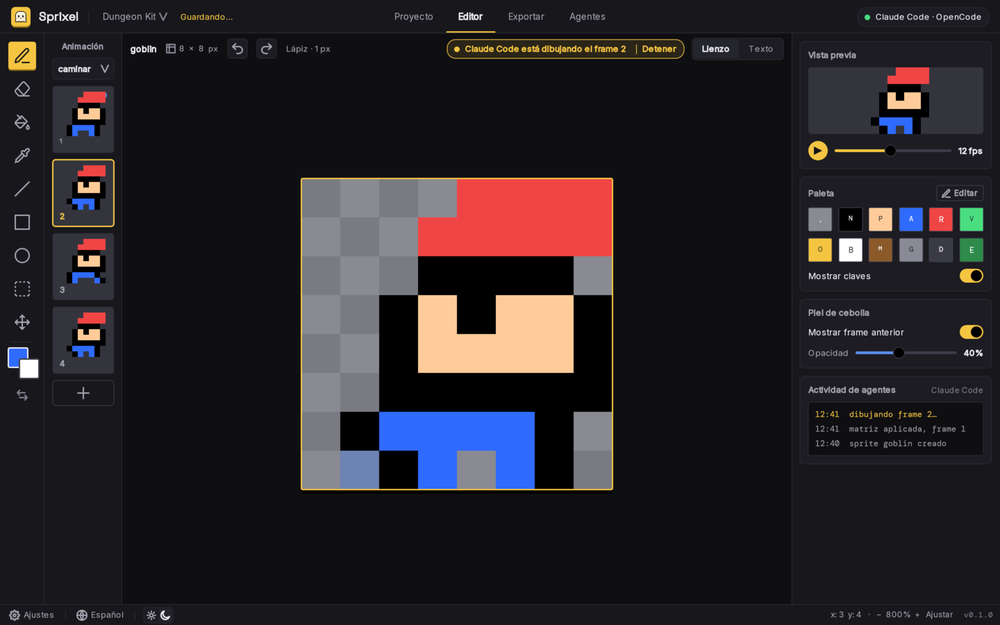

<p align="center">
  
</p>

<h1 align="center">Sprixel</h1>

<p align="center">
  <b>Pixel art para juegos.</b><br>
  Dibuja sprites y animaciones, o deja que tu IA los dibuje por ti.
</p>

<p align="center">
  
  
  
  <a href="README.md"></a>
</p>

<p align="center">
  
</p>

## ¿Qué es Sprixel?

Sprixel es un editor de pixel art de escritorio hecho para **sprites de juegos**.
Se inspira en Piskel, Aseprite y Pyxel Edit, con una interfaz limpia y simple, y
una gran diferencia: **tu IA puede usarlo**.

Claude Code y OpenCode se conectan a la app abierta y dibujan en el lienzo real
mientras tú miras. Puedes intervenir en cualquier momento, detener a la IA o
deshacer lo que hizo.

## Lo principal

- **Sprites y animaciones.** Frames, animaciones con nombre (caminar, reposo,
  ataque), vista previa en vivo con FPS y papel cebolla.
- **Cualquier tamaño de lienzo.** Tamaños predefinidos de 8x8 a 64x64, o
  cualquier tamaño hasta 512x512.
- **Todo en un proyecto.** Carpetas y sprites guardados como archivos de texto
  que funcionan bien con Git. Tu trabajo se guarda solo.
- **Hecho para la IA.** Un servidor MCP y una cuadrícula de texto simple dejan
  que una IA cree, dibuje y exporte sprites. Tú decides qué puede hacer.
- **Listo para tu juego.** Exporta una hoja de sprites con un archivo JSON, o
  archivos PNG sueltos.
- **Tu idioma y tu tema.** Español e inglés, claro y oscuro.

## Instalar

Necesitas dos cosas: la **app** y el **comando `sprixel`**. Los dos métodos de
abajo instalan las dos. Sistemas compatibles: Linux x64, macOS (Apple silicon e
Intel) y Windows x64.

### Método 1: un solo comando

Linux y macOS:

```sh
curl -fsSL https://github.com/Javier-GarciaP/sprixel/releases/latest/download/install.sh | sh
```

Windows (PowerShell):

```powershell
irm https://github.com/Javier-GarciaP/sprixel/releases/latest/download/install.ps1 | iex
```

Instala solo para tu usuario, comprueba el SHA-256 de cada descarga, añade
`sprixel` a tu PATH, pone Sprixel en el menú de aplicaciones con su icono y se
puede ejecutar otra vez sin problema. Abre una terminal nueva al terminar.

En una terminal muestra un resumen, te pide confirmar, y pregunta si quieres la
entrada del menú y si quieres conectar tu IA ahora, con una barra de progreso
para cada descarga. Para saltar las preguntas, añade `--yes` (mira la
[guía](docs/guide.es.md#las-preguntas-del-script)).

### Método 2: descargar desde GitHub

Descarga la app y el comando `sprixel` de tu sistema, más `checksums.txt`, desde
la [página de Releases](https://github.com/Javier-GarciaP/sprixel/releases), y
ponlos en su sitio. Los nombres de los archivos y los pasos exactos para cada
sistema están en la
[guía](docs/guide.es.md#método-2-descargar-desde-github).

### Comprobar

```sh
sprixel doctor
```

> **La primera vez que abras la app**, tu sistema puede mostrar un aviso, porque
> esta versión no está firmada. Es normal. Mira
> [qué hacer](docs/guide.es.md#la-primera-vez-que-lo-abres).

## Inicio rápido

1. Abre Sprixel desde el menú de aplicaciones (ahí tiene su icono), o ejecuta
   `sprixel start`.
2. Crea un proyecto y un sprite, y dibuja. Añade frames y ponle nombre a una
   animación.
3. Exporta una hoja de sprites y un archivo JSON desde la pestaña **Export**.

O deja que una IA dibuje (mira abajo).

## Úsalo con una IA

Conecta tu IA una sola vez:

```sh
sprixel mcp add claude      # Claude Code
sprixel mcp add opencode    # OpenCode
```

Permítela la primera vez en la pestaña **Agents**, y pide algo como:

> "Crea un goblin de 16x16 en la carpeta Characters con un ciclo de caminar de
> 4 frames."

Cómo funciona, en corto:

- La app es un **servidor MCP** en tu propio equipo. `sprixel mcp` es el puente
  pequeño entre tu herramienta de IA y la app.
- La IA aprende Sprixel de la propia app: las **instrucciones del servidor** (el
  flujo de trabajo), más de 45 **herramientas**, nueve **guías** que pide con
  `get_guide` (diseño, animación, paleta, ciclos de caminar...) y, para Claude
  Code, una **skill**.
- Tú tienes el control: **apruebas** cada IA, eliges sus **permisos**, y puedes
  usar **Stop** o **Undo** (deshacer).

La explicación completa está en la
[guía](docs/guide.es.md#cómo-entiende-la-ia-a-sprixel).

## Documentación

**Empieza por la [guía de Sprixel](docs/guide.es.md).** Cubre la instalación, el
uso de la app y todo sobre la IA y el MCP. Las demás páginas están en inglés.

| Documento | Qué contiene |
| --- | --- |
| [Guía de Sprixel](docs/guide.es.md) | Instalar (dos formas), usar la app, conectar una IA y cómo aprende |
| [Guía de uso](docs/usage.md) | Cada pantalla y atajo, y el comando `sprixel` |
| [IA y MCP](docs/ai-and-mcp.md) | Cada herramienta, código de error, permiso y las reglas de seguridad |
| [Formato de cuadrícula de texto](docs/text-grid-format.md) | El formato de texto que usa una IA para dibujar sprites |
| [Formato de exportación](docs/export-format.md) | La hoja de sprites, el JSON y los archivos PNG |
| [Motores de juego](docs/game-engines.md) | De un dibujo a Godot 4 y Unity, paso a paso |
| [Formato del proyecto](docs/project-format.md) | Versiones del formato y reglas para cambiar los archivos del proyecto |
| [Arquitectura](docs/architecture.md) | Cómo encajan la app, el CLI y los archivos del proyecto |
| [Diseño](docs/design/README.md) | La idea detrás de Sprixel y todas las pantallas (claro y oscuro) |
| [Hoja de ruta](docs/roadmap.md) | El plan de la versión 1 y las specs detrás |
| [Contribuir](CONTRIBUTING.md) | Ramas, commits, versiones y releases |
| [Software de terceros](docs/third-party.md) | Fuentes y dependencias, y sus licencias |

## Estado

Sprixel está en sus primeras versiones (0.1.x). Es temprano, así que espera
detalles por pulir:

- Está probada a mano en Linux. Windows y macOS solo se revisan con las pruebas
  automáticas.
- La exportación a GIF todavía no está lista.
- La app no está firmada.

Sprixel se construye a partir de specs escritas en [`openspec/`](openspec/). Sigue
la [hoja de ruta](docs/roadmap.md) para ver qué viene después.

## Compilar desde el código fuente

Necesitas Node y npm, Rust, Go y Git (mira
[Contribuir](CONTRIBUTING.md#prerequisites)).

```sh
git clone https://github.com/Javier-GarciaP/sprixel.git
cd sprixel
npm ci
npm run tauri dev           # abre la app
npm run build:cli           # compila el comando sprixel en bin/
```

## Contribuir

Sprixel es **código abierto** y las contribuciones son bienvenidas. Lee
[Contribuir](CONTRIBUTING.md). Los issues y pull requests son bienvenidos.

## Licencia

Copyright (c) 2026 Javier-GarciaP. Publicado bajo la **Licencia MIT**. Lee el
texto completo en [LICENSE](LICENSE). Las fuentes y otro software de terceros
tienen sus propias licencias, listadas en
[Software de terceros](docs/third-party.md).
