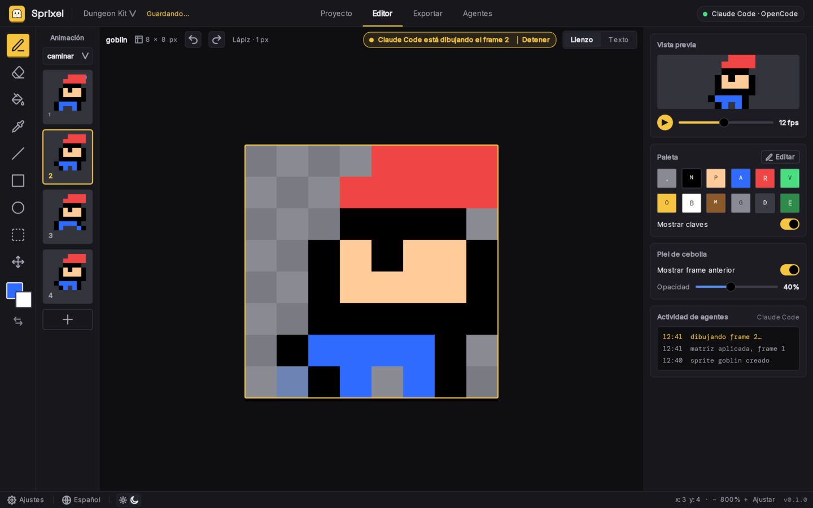

<p align="center">
  
</p>

<h1 align="center">Sprixel</h1>

<p align="center">
  <b>Pixel art for games.</b><br>
  Draw sprites and animations, or let your AI draw them for you.
</p>

<p align="center">
  
  
  
</p>

<p align="center">
  
</p>

## What is Sprixel?

Sprixel is a desktop pixel art editor made for **game sprites**. It is inspired
by Piskel, Aseprite and Pyxel Edit, with a clean and simple interface, and one
big difference: **your AI can use it**.

Claude Code and OpenCode connect to the running app and draw on the real canvas
while you watch. You can step in at any moment, stop the AI, or undo what it did.

## Highlights

- **Sprites and animations.** Frames, named animations (walk, idle, attack),
  live preview with FPS and onion skin.
- **Any canvas size.** Presets from 8x8 to 64x64, or any size up to 512x512
  (for example 120x30).
- **Everything in a project.** Folders and sprites, kept as plain text files
  that work well with Git. Your work is saved automatically.
- **Built for AI.** A simple text grid format and an MCP server let an AI
  create, draw and export sprites. You decide what the AI is allowed to do.
- **Ready for your game.** Export a sprite sheet with a JSON file, single
  PNG files or an animated GIF.
- **Your language and your theme.** Spanish and English, light and dark.

## Install

> **Not released yet.** Sprixel is in the planning stage. The commands below
> are the planned way to install it and will work from the first release.

Linux and macOS:

```sh
curl -fsSL https://github.com/Javier-GarciaP/sprixel/releases/latest/download/install.sh | sh
```

Windows (PowerShell):

```powershell
irm https://github.com/Javier-GarciaP/sprixel/releases/latest/download/install.ps1 | iex
```

The installer puts the app and the `sprixel` command on your computer. Then
connect your AI with one command:

```sh
sprixel mcp add claude      # Claude Code
sprixel mcp add opencode    # OpenCode
sprixel doctor              # check that everything works
```

> Sprixel is **not open source**. You can read the code, but you need written
> permission to use it. See [License](#license).

## Documentation

| Document | What is inside |
| --- | --- |
| [Usage guide](docs/usage.md) | How to use the app and the `sprixel` command |
| [AI and MCP](docs/ai-and-mcp.md) | Connecting an AI, available tools and security |
| [Text grid format](docs/text-grid-format.md) | The text format an AI uses to draw sprites |
| [Architecture](docs/architecture.md) | How the app, the CLI and the project files fit together |
| [Design](docs/design/README.md) | The idea behind Sprixel and all the screens (light and dark) |
| [Roadmap](docs/roadmap.md) | The plan for version 1 and the specs behind it |
| [Contributing](CONTRIBUTING.md) | Branches, commits, versions and releases |

## Status

Sprixel is being planned. The design is finished and the specs for version 1
are written in [`openspec/`](openspec/). The code will be built from these
specs, one at a time. Follow the [roadmap](docs/roadmap.md).

## License

Copyright (c) 2026 Javier-GarciaP. **All rights reserved.**

This is a proprietary project. No one may use, copy, modify or distribute it
without written permission from the copyright holder. Read the full text in
[LICENSE](LICENSE).
