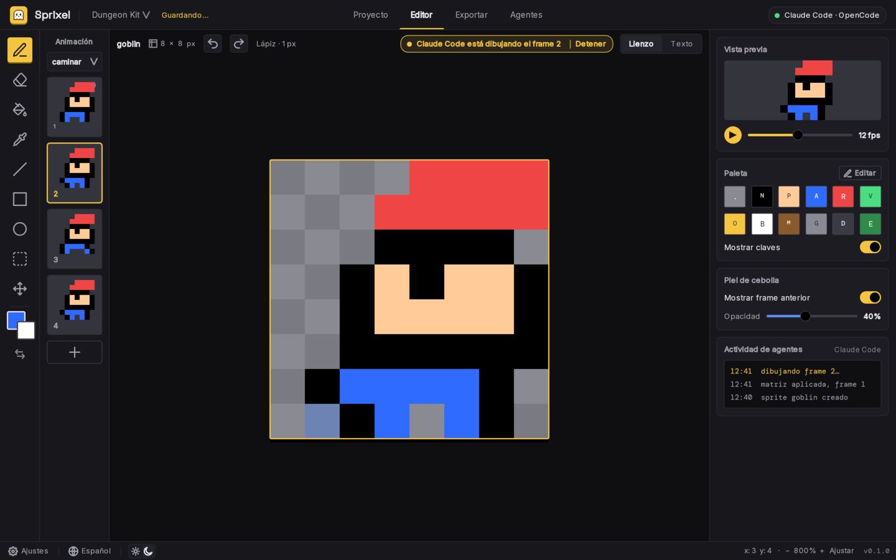

<p align="center">
  
</p>

<h1 align="center">Sprixel</h1>

<p align="center">
  <b>Pixel art for games.</b><br>
  Draw sprites and animations, or let your AI draw them for you.
</p>

<p align="center">
  
  
  
  <a href="README.es.md"></a>
</p>

<p align="center">
  
</p>

## What is Sprixel?

Sprixel is a desktop pixel art editor made for **game sprites**. It is inspired
by Piskel, Aseprite and Pyxel Edit, with a clean and simple interface, and one
big difference: **your AI can use it**.

Claude Code and OpenCode connect to the running app and draw on the real canvas
while you watch. You can step in at any moment, stop the AI, or undo what it did.

## Highlights

- **Sprites and animations.** Frames, named animations (walk, idle, attack),
  live preview with FPS and onion skin.
- **Any canvas size.** Presets from 8x8 to 64x64, or any size up to 512x512.
- **Everything in a project.** Folders and sprites, kept as plain text files
  that work well with Git. Your work is saved automatically.
- **Built for AI.** An MCP server and a simple text grid let an AI create, draw
  and export sprites. You decide what the AI is allowed to do.
- **Ready for your game.** Export a sprite sheet with a JSON file, or single PNG
  files.
- **Your language and your theme.** Spanish and English, light and dark.

## Install

You need two things: the **app** and the **`sprixel` command**. Both methods
below install both. Supported: Linux x64, macOS (Apple silicon and Intel) and
Windows x64.

### Method 1: one command

Linux and macOS:

```sh
curl -fsSL https://github.com/Javier-GarciaP/sprixel/releases/latest/download/install.sh | sh
```

Windows (PowerShell):

```powershell
irm https://github.com/Javier-GarciaP/sprixel/releases/latest/download/install.ps1 | iex
```

It installs for your user only, checks the SHA-256 of every download, adds
`sprixel` to your PATH, puts Sprixel in your applications menu with its icon and
is safe to run again. Open a new terminal afterwards.

On a terminal it shows a summary, asks you to confirm, and asks if you want the
menu entry and if you want to connect your AI now, with a progress bar for each
download. To skip the questions, add `--yes` (see the
[guide](docs/guide.md#the-questions-of-the-script)).

### Method 2: download from GitHub

Download the app and the `sprixel` command for your system, plus
`checksums.txt`, from the
[Releases page](https://github.com/Javier-GarciaP/sprixel/releases), and put
them in place. The file names and the exact steps for each system are in the
[guide](docs/guide.md#method-2-download-from-github).

### Check it

```sh
sprixel doctor
```

> **The first time you open the app**, your system may show a warning, because
> version 0.1.0 is not signed. This is expected. See
> [what to do](docs/guide.md#the-first-time-you-open-it).

## Quick start

1. Open Sprixel from your applications menu (it has its icon there), or run
   `sprixel start`.
2. Create a project and a sprite, and draw. Add frames and name an animation.
3. Export a sprite sheet and a JSON file from the **Export** tab.

Or let an AI draw (see below).

## Use it with an AI

Connect your AI once:

```sh
sprixel mcp add claude      # Claude Code
sprixel mcp add opencode    # OpenCode
```

Allow it the first time in the **Agents** tab, then ask:

> "Create a 16x16 goblin in the Characters folder with a 4 frame walk cycle."

How it works, in short:

- The app is an **MCP server** on your own computer. `sprixel mcp` is the small
  bridge between your AI tool and the app.
- The AI learns Sprixel from the app itself: the **server instructions** (the
  workflow), more than 45 **tools**, nine **guides** it asks for with
  `get_guide` (design, animation, palette, walk cycles...) and, for Claude Code,
  a **skill**.
- You stay in control: you **approve** each AI, choose its **permissions**, and
  can **Stop** or **Undo** it.

The full explanation is in the [guide](docs/guide.md#how-the-ai-understands-sprixel).

## Documentation

**Start with the [Sprixel guide](docs/guide.md).** It covers the install, the
use of the app and everything about the AI and MCP.

| Document | What is inside |
| --- | --- |
| [Sprixel guide](docs/guide.md) | Install (two ways), use the app, connect an AI and how it learns |
| [Usage guide](docs/usage.md) | Every screen and shortcut, and the `sprixel` command |
| [AI and MCP](docs/ai-and-mcp.md) | Every tool, error code, permission and the security rules |
| [Text grid format](docs/text-grid-format.md) | The text format an AI uses to draw sprites |
| [Export format](docs/export-format.md) | The sprite sheet, the JSON and the PNG files |
| [Game engines](docs/game-engines.md) | From a drawing to Godot 4 and Unity, step by step |
| [Project format](docs/project-format.md) | Format versions and the rules for changing the project files |
| [Architecture](docs/architecture.md) | How the app, the CLI and the project files fit together |
| [Design](docs/design/README.md) | The idea behind Sprixel and all the screens (light and dark) |
| [Roadmap](docs/roadmap.md) | The plan for version 1 and the specs behind it |
| [Contributing](CONTRIBUTING.md) | Branches, commits, versions and releases |
| [Third-party software](docs/third-party.md) | Fonts and dependencies, and their licenses |

## Status

Version 0.1.0 is the first public version. It is early, so expect rough edges:

- It is tested by hand on Linux. Windows and macOS are checked only by the
  automatic tests.
- GIF export is not ready yet.
- The app is not signed.

Sprixel is built from specs written in [`openspec/`](openspec/). Follow the
[roadmap](docs/roadmap.md) for what comes next.

## Build from source

You need Node and npm, Rust, Go and Git (see
[Contributing](CONTRIBUTING.md#prerequisites)).

```sh
git clone https://github.com/Javier-GarciaP/sprixel.git
cd sprixel
npm ci
npm run tauri dev           # opens the app
npm run build:cli           # builds the sprixel command into bin/
```

## Contributing

Sprixel is **open source** and contributions are welcome. Read
[Contributing](CONTRIBUTING.md). Issues and pull requests are welcome.

## License

Copyright (c) 2026 Javier-GarciaP. Released under the **MIT License**. Read the
full text in [LICENSE](LICENSE). The fonts and other third-party software have
their own licenses, listed in [Third-party software](docs/third-party.md).
